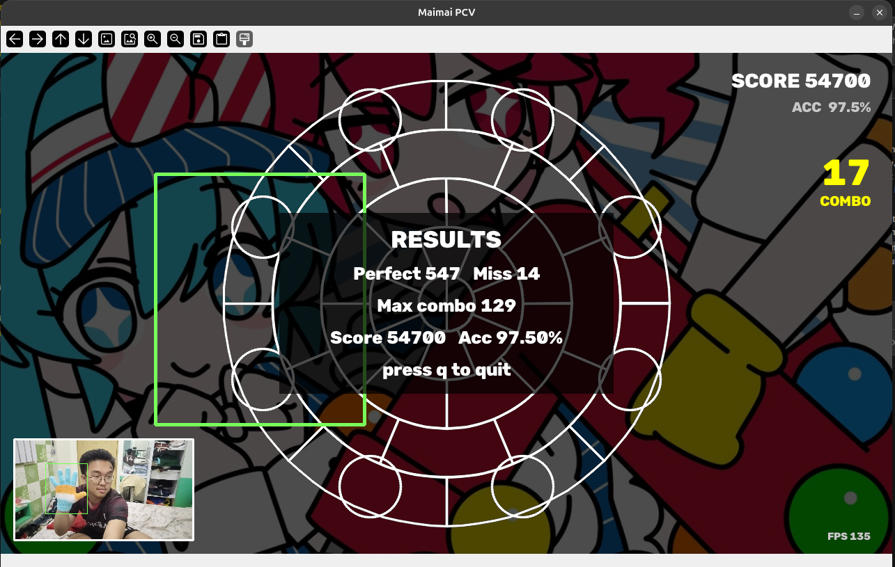

# Maimai-PCV

Game mirip maimai yang dimainkan pakai sarung tangan berwarna di depan kamera.
Program mencari sarung tangan lewat warnanya (HSV) lalu menggambar kotak di
sekelilingnya. Kalau kotak itu menyentuh lingkaran not pada waktu yang pas, not
dihitung PERFECT. Kalau tidak, MISS. Tugas mata kuliah PCV semester 5.

## Hasil



Ini hasil main tingkat Master (561 not): skor 54.700, akurasi 97,5 persen,
547 PERFECT, 14 MISS, max combo 129. Kotak hijau adalah sarung tangan yang
terdeteksi. Kotak kecil di kiri bawah adalah gambar kamera. Delapan lingkaran di
ring paling luar adalah tombol jalur tempat not mendarat. Skor dan combo ada di
kanan atas, FPS ada di kanan bawah (sekitar 135).

## Cara kerja

Tiap putaran loop di `test.py` mengerjakan enam hal ini:

```
1. ambil frame terbaru dari kamera
2. cari sarung tangan di frame        -> daftar kotak (boxes)
3. baca posisi lagu sekarang (ms)
4. update not, lalu cek kotak vs lingkaran not
5. gambar papan, not, kotak, dan HUD
6. tampilkan ke layar
```

### Kamera

Kamera HP dikirim ke komputer lewat scrcpy dan muncul sebagai `/dev/video0`.
`CameraStream` membaca kamera di thread sendiri dan hanya menyimpan frame yang
paling baru, jadi kamera yang lambat tidak membuat gambar game patah patah. Frame
dipotong jadi 1280x720 (`fit_cover`) lalu dibalik kiri kanan supaya seperti cermin.

### Mencari sarung tangan (`hand_tracking.py`)

Tidak ada MediaPipe dan tidak ada model. Semuanya dari warna, lewat enam langkah:

1. Frame diperkecil jadi lebar 320 supaya cepat. Caranya `INTER_AREA`, yang
   meratakan warna piksel di sekitarnya, jadi noise kamera berkurang.
2. Frame diubah dari BGR ke HSV. HSV memisahkan warna dari terang gelap, jadi lebih
   tahan kalau cahaya berubah.
3. Untuk tiap warna sarung tangan (biru muda dan oranye) dibuat mask dengan
   `cv2.inRange`. Hasilnya gambar hitam putih, putih artinya warnanya cocok. Titik
   kecil yang berserakan dibuang dengan `MORPH_OPEN`.
4. Warna putih hanya dihitung kalau menempel dekat biru atau oranye, jadi tembok
   putih di belakang tidak ikut.
5. Semua mask digabung, lalu celah kecil di antara warna ditutup dengan
   `MORPH_CLOSE` supaya satu sarung tangan jadi satu bentuk (blob).
6. Blob dicari dengan `cv2.findContours`, lalu dibuat kotaknya (`boundingRect`).
   Blob hanya dianggap sarung tangan kalau di dalamnya ada biru **dan** oranye.
   Panel biru atau pintu oranye di kamar tidak punya dua warna itu, jadi tidak lolos.

Kotaknya lalu dikalikan lagi ke ukuran asli (1280x720) dan ditambah sedikit
padding. Kelas `GloveTracker` menyimpan kotak terakhir selama 0,15 detik kalau
sarung tangan hilang sebentar, supaya kotak tidak berkedip. Rentang warna diukur
dari foto sarung tanganku. Kalau cahaya berubah, jalankan `calibrate_hsv.py` lagi.

### Chart, not, dan penilaian (`chart_parser.py`, `maidata.py`, `rhythm.py`)

Chart ditulis dalam format simai (teks dipisah koma, tiap koma satu slot waktu).
`maidata.py` membaca `maidata.txt`, `chart_parser.py` mengubah teksnya jadi daftar
event (tap, hold, touch, slide) lengkap dengan waktunya dalam milidetik.
`NoteManager` di `rhythm.py` mengubah tiap event jadi satu not: zona mana, posisi
pikselnya, kapan harus disentuh, dan (untuk slide) jalur yang dilewati.

Jalur 1 sampai 8 di chart ditaruh di ring luar seperti maimai asli, jalur 1 di
kanan atas lalu berputar searah jarum jam. Tiap frame ada dua langkah:

1. `update(song_ms)` memberi MISS pada not yang jendela waktunya sudah lewat, lalu
   menghitung `progress` (0 sampai 1) tiap not yang sedang tampil.
2. `judge(boxes, song_ms)` memberi PERFECT pada not yang kotak sarung tangannya
   menyentuh lingkaran target selama jendela waktunya (plus minus 200 ms).

Cek sentuh (`box_hits_circle`): cari titik di dalam kotak yang paling dekat dengan
pusat lingkaran, lalu lihat apakah jaraknya tidak lebih dari jari jari lingkaran.
Tidak ada GREAT atau GOOD. Hasilnya hanya PERFECT (100 poin) atau MISS (0 poin).

Waktu not selalu dihitung dari jam lagu (`pygame.mixer.music.get_pos`), bukan dari
jam kamera, jadi not tetap sinkron dengan musik.

### Gambar (`render.py`, `board.py`)

`board.py` berisi ukuran papan: empat ring (B, E, A, D), tiap ring punya 8 irisan,
ditambah lingkaran tengah (C). Titik tengah tiap zona dihitung dari radius tengah
ring dan sudutnya (`zone_center`). Papan digambar satu kali di awal, lalu tiap
frame tinggal ditempel ke layar.

Not tap dan hold mulai kecil di tengah papan lalu terbang ke tombol jalurnya sambil
membesar. Not touch diam di zonanya dan cincinnya mengecil. Slide berbentuk bintang
biru: bintang terbang ke jalur awal, lalu bergerak sepanjang garis jalur sampai
jalur akhir. Slide dinilai di jalur akhir saat bintang tiba. Latar diambil dari
`bg.jpg` lagu yang digelapkan.

## Isi repo

| file | isinya |
|---|---|
| `test.py` | program utama: loop kamera, cari sarung tangan, gambar, nilai |
| `hand_tracking.py` | mencari sarung tangan lewat warna HSV, hasilnya kotak |
| `rhythm.py` | `NoteManager`: bikin not dari chart, menilai, hitung skor dan combo |
| `render.py` | semua gambar: papan, not, bintang slide, kotak, preview kamera, HUD |
| `board.py` | ukuran papan dan posisi zona (hitungan saja, tanpa menggambar) |
| `chart_parser.py` | mengubah teks chart simai jadi daftar event |
| `maidata.py` | membaca `maidata.txt` (judul lagu dan chart tiap tingkat) |
| `calibrate_hsv.py` | alat mencari rentang HSV satu warna dengan slider |
| `music.py` | tes sinkron lagu dan chart tanpa kamera |
| `levels/<judul lagu>/` | satu lagu: `track.mp3`, `maidata.txt`, `bg.jpg`, dan lainnya |
| `docs/` | gambar untuk README |

## Cara menjalankan

Sekali saja, kalau `.venv` belum ada:

```
python3 -m venv .venv
.venv/bin/pip install numpy opencv-python pygame-ce
```

Setiap kali main:

```
cd "/run/media/darrencasper/New Volume/Semester_5_Kuliah/Maimai-PCV"
source .venv/bin/activate
python3 test.py
```

Jalankan scrcpy dulu supaya kamera HP muncul di `/dev/video0`:

```
scrcpy --video-source=camera --camera-id=0 --camera-size=1280x720 --camera-fps=30 --v4l2-sink=/dev/video0 --no-audio
```

HP ini juga bisa 120 fps. Tambahkan `--camera-high-speed --camera-fps=120` untuk
mencobanya. Kalau gambarnya miring, tambahkan `--capture-orientation=90`. Gambar
harus landscape, karena gambar portrait akan terpotong tipis. Tekan `q` di window
untuk keluar, hasil akhir juga dicetak di terminal.

Setelan ada di bagian atas `test.py`:

| konstanta | fungsinya |
|---|---|
| `PLAY_CHART` | `False` untuk mode tes sarung tangan saja, tanpa lagu dan not |
| `DIFFICULTY` | 2 Basic, 3 Advanced, 4 Expert, 5 Master, 6 Re:Master |
| `NOTE_SPEED` | kecepatan not, 4 sampai 5 santai, 6 sampai 7,5 umum dipakai |
| `AUDIO_OFFSET_MS` | geser timing kalau not terasa terlalu cepat atau lambat |
| `CAMERA_INDEX` | nomor kamera, 0 artinya `/dev/video0` (keluaran scrcpy) |
| `RUN_PARSER_TEST` | `True` hanya mengecek parser lalu keluar, kamera tidak dibuka |

Setelan lain yang sering diubah: `BLUE`, `ORANGE`, `WHITE`, `HOLD_SECONDS` di
`hand_tracking.py`, `HIT_WINDOW_MS` di `rhythm.py`, dan `TARGET_RADIUS` di `board.py`.

Skrip bantu:

```
python3 calibrate_hsv.py   # cari rentang HSV satu warna sarung tangan
python3 maidata.py         # ringkasan semua tingkat kesulitan satu lagu
python3 music.py           # cek lagu dan chart sinkron (25 detik pertama)
python3 chart_parser.py    # parse satu chart contoh
python3 rhythm.py          # jumlah not per zona
```

Diuji di Python 3.14, OpenCV 5.0, NumPy 2.5, pygame-ce 2.5.8. `pip install pygame`
gagal di Python 3.14 karena belum ada wheel, jadi pakai `pygame-ce`. Cara
`import`-nya tetap `import pygame`.

## Masalah yang masih ada

1. Tracking warna gampang terganggu cahaya dan latar. Rentang warna diukur dari satu
   foto sarung tangan (biru muda H sekitar 93, oranye H sekitar 19, putih V sekitar
   180). Kalau cahaya berubah, kalibrasi ulang dengan `calibrate_hsv.py`. Benda biru,
   oranye, atau putih di latar bisa bikin kotak palsu. Syarat "biru dan oranye dalam
   satu blob" menyaring sebagian besar, tapi tidak semuanya. Kalau tiap sarung
   tangan hanya satu warna, syarat itu harus diubah.
2. Timing belum dikalibrasi. `AUDIO_OFFSET_MS` masih 0 dan perlu disetel sesuai
   kamera, audio, dan reaksi pemain.
3. Hold dinilai sebagai satu sentuhan di awalnya, belum ada penilaian lepas hold.
   Slide dinilai sekali di jalur akhir, kotak tidak dicek sepanjang jalur. Bentuk
   lengkung (`>`, `p`, `s`, dan lainnya) digambar sebagai garis lurus. Slide yang
   mulai dan berakhir di jalur yang sama tampil sebagai bintang diam.
4. Tidak ada gerakan menekan, jadi tangan yang diam di atas lingkaran mengenai semua
   not di tempat itu. Kotak yang besar (tangan terbuka) juga bisa menyentuh beberapa
   lingkaran sekaligus.
5. Ukuran papan tertulis tetap untuk frame 1280x720 dan di tengah layar. Belum ada
   kalibrasi ke posisi pemain.
6. Folder `__pycache__/` masih ikut di git dan belum ada `.gitignore`.
