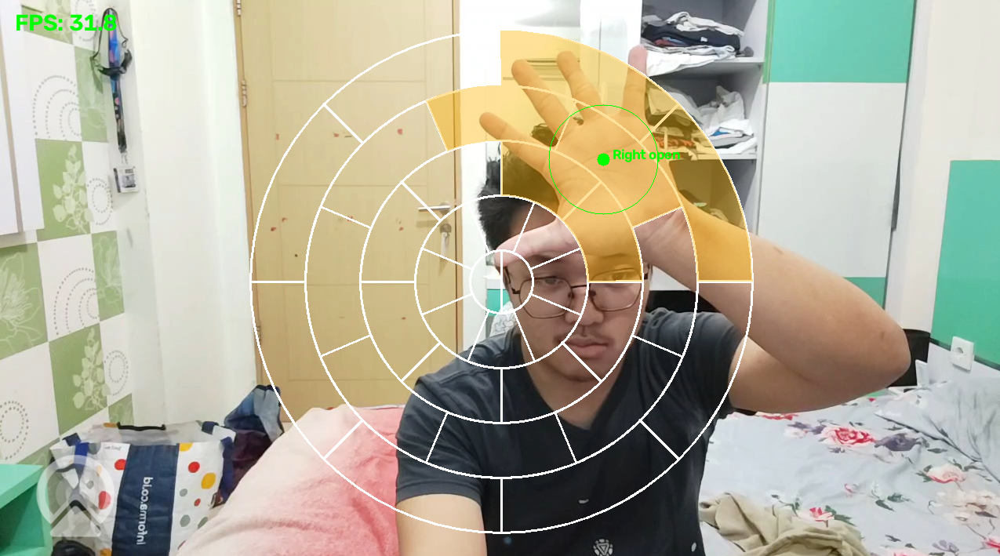

# Maimai-PCV

Rhythm game ala maimai yang dimainkan pakai tangan di depan webcam. Program
melacak posisi kedua telapak tangan di atas papan sensor virtual, membaca
kepalan tangan sebagai "hit", lalu mencocokkannya dengan chart lagu dan memberi
nilai PERFECT / GREAT / GOOD / MISS. Tugas mata kuliah PCV (semester 5).

## Isi repo

- `test.py` — aplikasi utama: tracking tangan + papan + game rhythm (loop kamera).
- `chart_parser.py` — parser satu chart teks (format simai) jadi daftar event
  bertimestamp: tap, hold, touch, slide.
- `maidata.py` — pembaca file `maidata.txt` (metadata lagu + chart per tingkat
  kesulitan), memanggil `chart_parser`.
- `rhythm.py` — `NoteManager`: memetakan posisi chart ke zona papan, memunculkan
  not, menilai hit, menghitung skor / combo / akurasi.
- `music.py` — skrip terpisah untuk cek sinkronisasi audio vs chart (tanpa kamera).
- `hand_tracking.py` — deteksi tangan berbasis HSV + contour (tanpa MediaPipe):
  mask warna kulit/glove, centroid contour jadi posisi telapak, solidity
  contour jadi deteksi kepalan.
- `calibrate_hsv.py` — alat bantu cari rentang HSV yang pas (trackbar live).
- `levels/<judul lagu>/` — satu lagu: `track.mp3`, `maidata.txt`, `bg.jpg`, dst.

## Cara menjalankan

```
python test.py
```

Jalan langsung sebagai game: memuat chart メズマライザー (default tingkat Basic),
memainkan lagunya, dan not-not terbang masuk ke zona-nya. Kepalkan tangan di
zona pas lingkaran not mengecil. Tekan `q` di window untuk keluar (hasil akhir
juga dicetak ke console).

Pengaturan ada di blok atas `test.py`:

| konstanta | fungsi |
|---|---|
| `PLAY_CHART` | `False` = mode tracking bebas, tanpa lagu / not |
| `DIFFICULTY` | 2 Basic … 6 Re:Master |
| `NOTE_SPEED` | kecepatan not ala maimai (4–5 santai, 6–7.5 umum) |
| `AUDIO_OFFSET_MS` | geser timing kalau terasa kecepetan / kelambatan |
| `CAMERA_INDEX` | index webcam (Camo biasanya `1`, webcam laptop `0`) |
| `SHOW_TRACKING_DEBUG` | tampilkan titik mentah vs titik prediksi untuk tuning |
| `RUN_PARSER_TEST` | `True` = cuma cek parser lalu keluar, tak buka kamera |

Skrip pendukung:

```
python maidata.py       # ringkasan semua tingkat kesulitan di satu lagu
python music.py         # cek sinkronisasi lagu vs chart (25 detik pertama)
python chart_parser.py  # parse satu chart contoh
python rhythm.py        # cek pemetaan posisi -> zona
python calibrate_hsv.py # cari rentang HSV yang pas buat kulit/glove-mu
```

Diuji di Python 3.14, OpenCV 5.0, NumPy 2.5, pygame-ce 2.5.8.

Catatan pemasangan: `pip install pygame` gagal di Python 3.14 (belum ada wheel,
kompilasi dari source gagal). Pakai **`pip install pygame-ce`** — API sama,
tinggal `import pygame`.

Catatan tracking: deteksi tangan **tidak** pakai MediaPipe atau model apa pun
— murni threshold HSV + geometri (lihat bagian "Tracking tangan" di bawah).
Rentang HSV bawaan di `hand_tracking.py` cuma titik awal; jalankan
`calibrate_hsv.py` untuk menyetelnya ke kulit/pencahayaan/kamera-mu sendiri
sebelum main.

## Progress sejauh ini



**Papan.** 34 zona ala maimai: empat ring konsentris masing-masing 8 zona (label
B / E / A / D dari dalam ke luar) plus dua zona setengah lingkaran di tengah
(C1 kiri, C2 kanan). Ring berselang-seling diputar 22.5° supaya sambungannya
saling mengunci. Pencarian zona murni perhitungan polar — radius memilih ring,
sudut memilih slice. Papan digambar sekali ke template lalu di-`cv2.max` tiap
frame (bukan ~200 panggilan gambar).

**Tracking tangan.** Tanpa MediaPipe atau model apa pun — `hand_tracking.py`
threshold frame ke HSV (kulit, atau nanti warna glove per tangan), bersihkan
mask-nya (morphology open+close), lalu ambil hingga 2 contour terbesar sebagai
tangan. Posisi telapak = centroid contour (image moments), dinormalisasi 0..1
sama seperti landmark dulu. Karena tak ada label handedness dari model, tiap
tangan tetap dilabeli "Left"/"Right" yang sama selama frame-ke-frame dengan
mencocokkan ke centroid terdekat sebelumnya; tangan baru dilabeli dari posisi
kiri-ke-kanan di layar. Pipeline: capture di thread sendiri, deteksi HSV
sinkron tiap frame kamera baru (murah, tak perlu thread/async terpisah), filter
One-Euro per tangan meredam jitter centroid (blob HSV lebih berisik
dibanding landmark dulu). Titik debug (abu = mentah, hijau = smoothed) tetap
ada untuk tuning `LATENCY_COMP`, walau sekarang efeknya kecil karena tak ada
lagi jeda capture->hasil yang perlu dikompensasi.

**Deteksi kepalan.** Murni geometri contour: solidity = luas contour dibagi
luas convex hull-nya. Kepalan hampir konveks sempurna (solidity tinggi);
telapak terbuka punya celah antar-jari yang menurunkan solidity. Di atas
`FIST_SOLIDITY` (default 0.88) dihitung kepalan. Kepalan = hit; kepalan lalu
lepas = hold.

**Hit scan.** Telapak diperlakukan sebagai disc ~70 px, bukan titik. Kalau
menutupi 2–3 zona bersebelahan, semuanya ikut kena — sengaja, supaya toleran.

**Chart parser + maidata loader.** Membaca `maidata.txt` (format simai):
metadata `&title` / `&artist` / `&first`, dan chart `&inote_2..6` per kesulitan.
Parser menangani: tap `1`–`8`, touch `A1`–`E8` dan `C1`/`C2`, hold `Nh[div:mult]`,
marker `x` (EX) / `b` (break), ganti BPM `(185)` dan pembagian ketukan `{8}`
inline, serta slide — termasuk rantai (`1-7-5-3`), slide V (`2V46`), campur
bentuk (`6p5>7`), dan fork (`4-8*-2`). Diuji ke 5 kesulitan メズマライザー: chart
berakhir ~154,4 s vs lagu 157 s (timing pas).

**Game rhythm.** `test.py` sekarang: memuat chart+lagu, memunculkan not sebagai
lingkaran yang mengecil ke zona, menilai kepalan terhadap not terdekat (window
PERFECT ±45 ms, GREAT ±90, GOOD ±140, MISS >200), HUD skor/akurasi/combo, dan
layar hasil saat chart selesai. Posisi chart `1`–`8` dipetakan ke ring `D`,
touch `A/B/E` ke zona senama.

## Log progres

Dicatat per tanggal, mengikuti commit. Entri terbaru di atas.

<!-- Tiap habis commit, tambahkan baris di bawah tanggalnya:
     `hash-pendek` — ringkasan singkat apa yang berubah.
     Kalau tanggalnya baru, buat sub-judul ### tanggal baru di paling atas. -->

### 2026-09-15

- _(belum di-commit)_ — **lepas MediaPipe sepenuhnya**. Tracking tangan sekarang
  murni HSV + geometri OpenCV: `hand_tracking.py` (baru) threshold HSV ->
  contour terbesar -> centroid jadi posisi telapak, solidity contour (luas
  contour / luas convex hull) jadi deteksi kepalan. Deteksi jalan sinkron tiap
  frame kamera baru (bukan lagi thread + `LIVE_STREAM` async terpisah).
  Tambah `calibrate_hsv.py` buat nyari rentang HSV yang pas via trackbar live.
  `hand_landmarker.task` dan import `mediapipe` di `test.py` dihapus. Sudah
  disiapkan `GLOVE_HSV` di `hand_tracking.py` sebagai placeholder mode glove
  warna (per-tangan) buat nanti.

### 2026-09-02

- _(belum di-commit)_ — **game rhythm jadi**. Ditambah `maidata.py` (loader
  simai) dan `rhythm.py` (`NoteManager`: pemetaan zona, penilaian, skor/combo).
  `chart_parser.py` di-upgrade besar: touch note, marker x/b, `(bpm)` inline,
  dan parsing slide yang benar (rantai, V, campur bentuk, fork). `music.py` untuk
  tes sinkronisasi audio. `test.py` disambungkan: not terbang masuk, kepalan
  dinilai, HUD + layar hasil, `NOTE_SPEED` ala maimai. Kerja tracking latensi:
  ukur pipeline (~25 deteksi/detik, ~55–75 ms), setel `LATENCY_COMP` /
  `MAX_EXTRAP_S`, tambah `DECEL_SNAP` anti-overshoot dan titik debug mentah vs
  prediksi. Pasang `pygame-ce` (pygame biasa gagal build di Python 3.14).
  Tambah folder `levels/メズマライザー/`.
- `33325fa` — logika parser tambahan untuk hold.
- `967b50a` — tambah screenshot hasil program ke `docs/screenshot.png`.
- `0b77a8d` — mulai pakai README ini sebagai catatan progres.
- `0f416d5` — fase 2: papan 34 zona (ring B/E/A/D + C1/C2 di tengah), hit scan
  disc, deteksi kepalan untuk tap, mekanik hold. Termasuk kerja sebelum commit
  pertama: pindah ke MediaPipe Tasks API (Python 3.14 / MediaPipe 1.x menghapus
  `mp.solutions`), capture di thread terpisah, deteksi async `LIVE_STREAM`,
  smoothing One-Euro + ekstrapolasi antar-deteksi.

## Masalah / keterbatasan yang diketahui

- **Tracking HSV rentan pencahayaan/latar.** Mask warna kulit gampang meleset
  kalau lampu berubah atau ada benda sewarna kulit di latar belakang — kalibrasi
  ulang tiap sesi lewat `calibrate_hsv.py`. Rencana: pindah ke glove/marker warna
  solid (`GLOVE_HSV` di `hand_tracking.py` sudah ada placeholder-nya) begitu
  barangnya ada, karena satu warna solid jauh lebih stabil di-threshold
  dibanding kulit dan sekalian menyelesaikan handedness secara pasti.
- **Timing game belum dikalibrasi.** `AUDIO_OFFSET_MS = 0`. Perlu disetel per
  setup (latensi kamera + audio + reaksi).
- Hold dan slide dinilai sebagai satu tap di titik/waktu awalnya — belum ada
  penilaian lepas-hold atau jalur slide.
- Ring `1`–`8` dipetakan ke wedge luar `D` yang tipis — target kecil. Kalau susah,
  ganti `RING_TO_ZONE` di `rhythm.py` ke ring `A`.
- Deteksi kepalan (solidity contour) bisa salah kalau tangan menghadap miring
  ke kamera atau mask HSV terpotong sebagian (lengan panjang, bayangan, dll).
- Tanpa handedness dari model, label "Left"/"Right" murni tebakan posisi +
  kontinuitas — bisa tertukar kalau dua tangan saling menyilang cepat.
- Geometri papan hard-coded untuk frame 1280×720, berpusat di tengah. Belum ada
  kalibrasi ke posisi pemain.
- `test.py` sudah besar dan jalan otomatis saat di-import — perlu dibungkus
  `if __name__ == "__main__"` sebelum dipecah jadi modul.
- `__pycache__/` masih ikut ke-track git; perlu `.gitignore`.

## Selanjutnya

- Kalibrasi `AUDIO_OFFSET_MS` + kalibrasi papan ke posisi pemain
- Penilaian hold (lepas di waktu yang benar) dan slide (susuri jalur)
- Layar pemilihan lagu / kesulitan, bukan konstanta
- Isi `GLOVE_HSV` begitu glove/marker warna sudah ada, pindah `TRACK_MODE`
  ke `"glove"` untuk tracking yang lebih stabil + handedness pasti
- `.gitignore` + pecah `test.py` jadi modul
